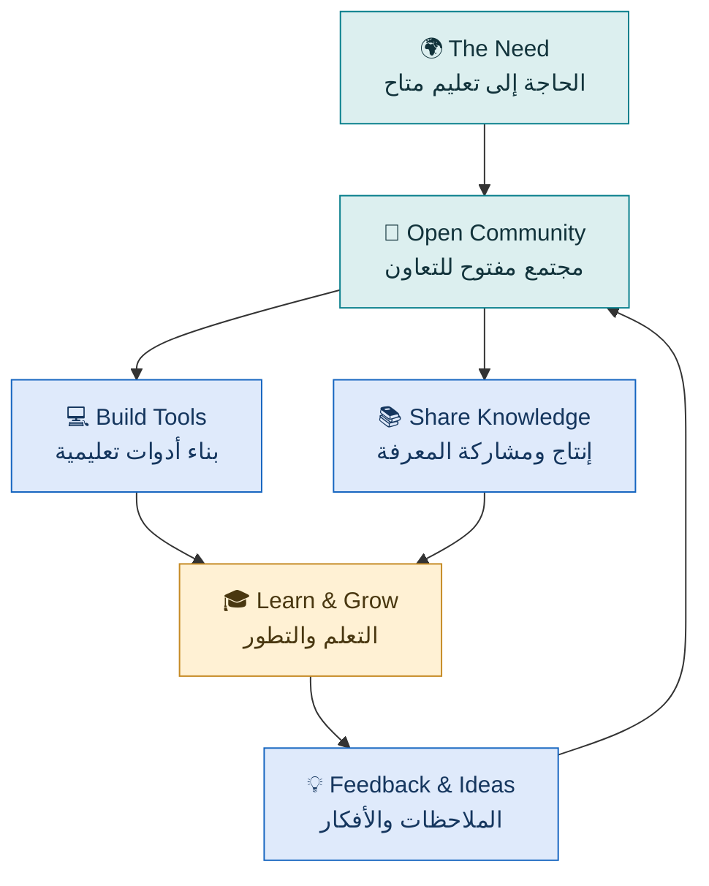
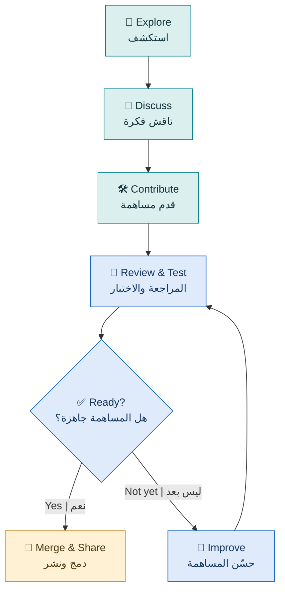
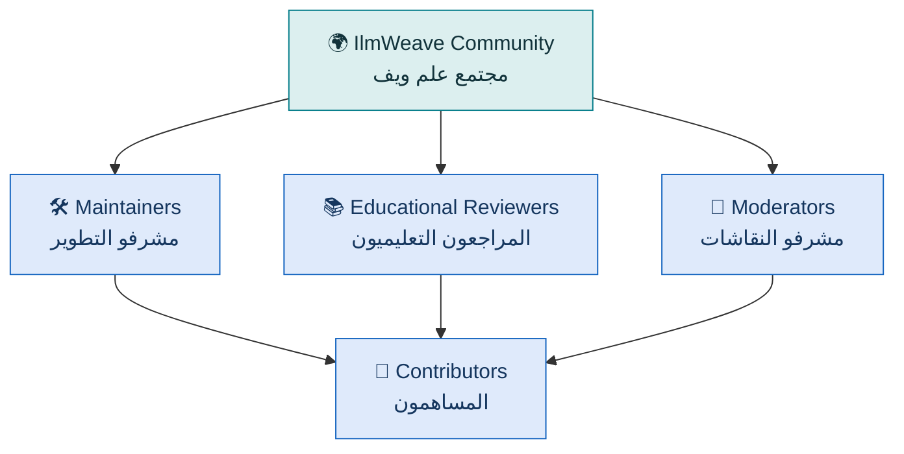

# 🧵 IlmWeave

### عِلم ويف | Knowledge for Everyone

**Knowledge is meant to be shared, not kept behind barriers.**

**العلم حق للجميع، والمعرفة تنمو عندما نتشاركها.**

 

 

### 🌍 Learn. Share. Build. Together.

A free, open-source community dedicated to making education, knowledge, and technology accessible to everyone.

مجتمع مجاني ومفتوح المصدر يجمع الناس لبناء المعرفة وتطوير الأدوات التعليمية ومشاركتها مع الجميع.

**[Explore Our Community](https://github.com/IlmWeave)** · **[Our Repositories](https://github.com/orgs/IlmWeave/repositories)** · **[Get Involved](#-get-involved--كيف-تساهم)**

---

## ✨ Welcome to IlmWeave | أهلًا بك في علم ويف

> **One idea can inspire a learner. One contribution can help thousands.**
>
> فكرة واحدة قد تلهم متعلمًا، ومساهمة واحدة قد تساعد آلافًا.

We believe that financial circumstances should never determine someone's opportunity to learn.

نؤمن بأن الظروف المادية لا ينبغي أن تمنع أي إنسان من الوصول إلى العلم والمعرفة.

IlmWeave brings together developers, educators, students, researchers, designers, translators, and volunteers to create useful tools and open educational resources.

يجمع علم ويف المطورين والمعلمين والطلاب والباحثين والمصممين والمترجمين والمتطوعين لبناء أدوات نافعة وموارد تعليمية مفتوحة.

---

## 🌟 Our Vision & Mission | رؤيتنا ورسالتنا

<table>
<tr>
<td width="50%" valign="top">

### 🌍 Our Vision | رؤيتنا

**A world where learning has no barriers.**

We envision a future where everyone can learn, explore, and create regardless of their background or financial circumstances.

**عالم لا تقف فيه العوائق أمام العلم.**

نطمح إلى مستقبل يستطيع فيه كل إنسان التعلم والاستكشاف والإبداع، بغض النظر عن خلفيته أو ظروفه المادية.

</td>
<td width="50%" valign="top">

### 🎯 Our Mission | رسالتنا

**We build knowledge together.**

To develop and share free, open-source tools and resources that make learning clearer, simpler, and more accessible.

**نبني المعرفة معًا.**

تطوير ونشر أدوات وموارد مجانية ومفتوحة المصدر تجعل التعلم أوضح وأسهل وأكثر وصولًا للجميع.

</td>
</tr>
</table>

---

## 🧵 Why IlmWeave? | لماذا علم ويف؟

### Ilm + Weave = Knowledge Woven Together

**عِلم + نَسْج = معرفة نصنعها معًا**

**Ilm (عِلم)** is the Arabic word for knowledge.

**Weave** means joining individual threads to create something greater.

Every person brings a thread:

- 💻 Developers bring technology.
- 📚 Educators bring understanding.
- 🎓 Students bring experience.
- 🎨 Designers bring clarity.
- 🌐 Translators connect languages.
- 🤝 Volunteers bring people together.

And together, we weave knowledge that everyone can benefit from.

كل مساهم يحمل خيطًا من المعرفة أو المهارة، وباجتماع هذه الخيوط ننسج شيئًا أكبر، يستطيع الجميع الاستفادة منه.

---

## 🗺️ How IlmWeave Works | كيف يعمل علم ويف؟

**The cycle never stops: collaboration creates knowledge, and knowledge creates opportunity.**

التعاون يصنع المعرفة، والمعرفة تفتح فرصًا جديدة، ثم تعود التجارب لتطوّر المجتمع.

---

## 💎 Our Core Principles | مبادئنا

| | Principle | المبدأ |
|:--:|---|---|
| 🌍 | **Knowledge for Everyone** | العلم متاح للجميع |
| 🔓 | **Open by Nature** | الانفتاح أساس عملنا |
| 💚 | **Free Access** | نعمل من أجل إتاحة التعلم دون رسوم ترخيص |
| 🧩 | **Simplicity First** | البساطة قبل التعقيد |
| 🤝 | **Community Collaboration** | التعاون أساس التطوير |
| 🛡️ | **Privacy & Responsibility** | الخصوصية والمسؤولية |
| 🔬 | **Accuracy & Integrity** | الدقة والنزاهة العلمية |
| 🌱 | **Continuous Improvement** | التحسين المستمر |

### Our Design Philosophy | فلسفة التصميم

> **Make complex technology simple for the people who use it.**
>
> اجعل التقنية المعقدة بسيطة لمن يستخدمها.

We believe the best educational tools should help people focus on learning, not on figuring out how to use an application.

نؤمن بأن أفضل الأدوات التعليمية تجعل الطالب يركز على التعلم، لا على محاولة فهم طريقة استخدام البرنامج.

---

## 🚀 Our First Initiative | مبادرتنا الأولى

<table>
<tr>
<td valign="top">

### 🧠 AI Private Tutor

**Status: In Development | قيد التطوير**

An open-source AI-assisted learning application designed to help students understand concepts, practise step by step, and receive useful feedback.

تطبيق تعليمي مفتوح المصدر نعمل على تطويره لمساعدة الطلاب على فهم المفاهيم والتدرب خطوة بخطوة والحصول على ملاحظات تساعدهم على التعلم.

**Development goals | أهداف التطوير:**

- 📖 Clear explanations — شروحات واضحة.
- 🧮 Guided practice — تدريب تفاعلي.
- 📷 Handwritten math recognition — قراءة الحلول الرياضية المصورة.
- ✅ Mathematical verification — التحقق من الإجابات.
- 📈 Learning progress — متابعة تقدم الطالب.
- 🌐 Accessible learning — تعليم سهل الوصول.

Some capabilities are still being developed and tested. This is not an announcement of a completed public release.

بعض الوظائف ما زالت قيد التطوير والاختبار، ولم نعلن بعد عن إصدار عام مكتمل.

</td>
</tr>
</table>

**IlmWeave is bigger than one application.**

علم ويف ليس مجرد تطبيق واحد؛ بل مساحة مفتوحة لبناء مشاريع معرفية وتعليمية مستقبلية.

---

## 👥 Everyone Can Contribute | الجميع يستطيع المساهمة

**You do not need to be a professional programmer to help.**

**لا يشترط أن تكون مبرمجًا محترفًا لتساهم معنا.**

| Role | الدور | Contribution |
|---|---|---|
| 💻 Developer | مطور | Software and tools — البرمجيات والأدوات |
| 👩‍🏫 Educator | معلم | Educational content — المحتوى التعليمي |
| 🎓 Student | طالب | Feedback and testing — التجربة والملاحظات |
| 🔬 Researcher | باحث | Methods and evaluation — البحث والتقييم |
| 🎨 Designer | مصمم | UX and accessibility — التصميم وسهولة الاستخدام |
| 🌐 Translator | مترجم | Language accessibility — إتاحة المعرفة بلغات مختلفة |
| 📝 Writer | كاتب | Documentation — التوثيق |
| 🛡️ Reviewer | مراجع | Quality and security — الجودة والأمان |

---

## 🔄 Your Contribution Journey | رحلة مساهمتك

Every contribution is reviewed for quality, security, and educational value.

تُراجع المساهمات لضمان الجودة والأمان والفائدة التعليمية.

---

## 🧭 Get Involved | كيف تساهم؟

**Getting started is simple:**

1. Explore the available projects. — استكشف المشاريع.
2. Read the relevant documentation. — اقرأ التوثيق.
3. Report a problem or propose an idea. — بلّغ عن مشكلة أو اقترح فكرة.
4. Submit a contribution. — أرسل مساهمتك.
5. Learn from feedback and improve. — استفد من المراجعة وطوّر عملك.

Contribution guidelines and additional community spaces will be introduced as the organization grows.

سنضيف إرشادات المساهمة ومساحات المجتمع تدريجيًا مع نمو المنظمة.

---

## 🏛️ Community Governance | إدارة المجتمع

Our goal is to build a sustainable, community-led initiative that does not depend on its founder's daily involvement.

هدفنا بناء مجتمع مستدام يستطيع الاستمرار والتطور دون الاعتماد على حضور المؤسس يوميًا.

**Governance is a long-term goal.**

Trusted maintainers and reviewers will be appointed progressively. The diagram represents the intended structure, not an existing fully staffed team.

**هذا الهيكل يمثل التنظيم المستهدف مستقبلًا، وليس فريقًا مكتملًا حاليًا.** وستُمنح الصلاحيات تدريجيًا للمساهمين الموثوقين.

---

## 🌐 One Community, Many Languages | مجتمع واحد بلغات متعددة

**Different languages. Shared knowledge.**

**لغات مختلفة، ومعرفة مشتركة.**

Arabic and English are welcome in our community. Technical work may use English for consistency, while documentation and participation can support both languages.

نرحب بالعربية والإنجليزية في المجتمع. وقد تُستخدم الإنجليزية في العمل التقني لتوحيد المصطلحات، مع دعم التوثيق والمشاركة باللغتين.

As the community grows, we hope to support additional languages.

ونطمح إلى دعم لغات إضافية مستقبلًا.

---

## 🔐 Open, Responsible, and Human | انفتاح بمسؤولية

We believe openness should go hand in hand with:

- Protecting user privacy — حماية خصوصية المستخدمين.
- Respecting contributors — احترام المساهمين.
- Reviewing educational accuracy — مراجعة الدقة العلمية.
- Respecting software licenses — احترام تراخيص البرمجيات.
- Documenting important decisions — توثيق القرارات المهمة.
- Keeping learning accessible — إبقاء التعلم متاحًا.

Our policies, contribution rules, and licensing details will be documented as individual projects are prepared for public release.

ستُوثق سياسات المجتمع وإرشادات المساهمة والتراخيص عند تجهيز المشاريع للنشر العام.

---

## 💌 A Message to Every Learner | رسالة لكل متعلم

> **Your circumstances do not define your potential.**
>
> **قدراتك لا تحددها ظروفك.**
>
> Somewhere in the world, someone wants to learn but lacks the resources to begin.
>
> في مكان ما من العالم، يوجد شخص يريد أن يتعلم، لكنه لا يملك الإمكانات التي تساعده على البداية.
>
> We build IlmWeave so that knowledge can reach more people.
>
> نبني علم ويف حتى تصل المعرفة إلى عدد أكبر من الناس.

---

### 🧵 Every Thread Matters | كل خيط يصنع فرقًا

**Every idea. Every lesson. Every improvement. Every contributor.**

**كل فكرة، كل درس، كل تحسين، وكل مساهم يصنع فرقًا.**

 

# IlmWeave

### Knowledge for Everyone. Woven Together.

**العلم للجميع، ننسجه معًا.**

 

**[🌍 Explore IlmWeave](https://github.com/IlmWeave)**

*Free knowledge grows when we build it together.*

